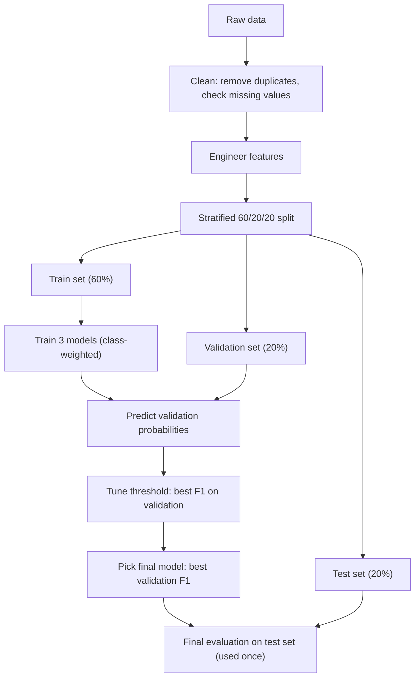
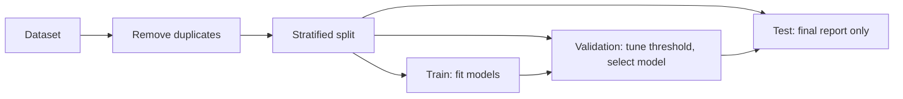

# E-Commerce Purchase Intention Prediction: Two Datasets, Three Models

## Project Overview

This project develops an end-to-end predictive analytics solution for predicting whether an online shopping session will result in a purchase.

The **same protocol** is applied to two independent datasets, so the approach can be tested on different data. The workflow covers data understanding, cleaning, feature engineering, preprocessing, class-imbalance handling, model comparison, threshold optimization, final evaluation and interpretation.

The final model on both datasets is a **class-weighted Gradient Boosting classifier with a threshold tuned on a validation set**.

| | Dataset 1 | Dataset 2 |
|---|---|---|
| Name | Clickstream purchase propensity | Online Shoppers Purchasing Intention (UCI) |
| Target | `ordered` (1 = purchase) | `Revenue` (True = purchase) |
| Sessions | **455,401** | **12,330** raw, **12,205** after duplicate removal |
| Purchase rate | **4.2%** | **15.6%** |
| Duplicates | none (checked by `UserID`) | **125** removed |
| Missing values | **0** | **0** |
| File | `data/dataset1_clickstream_training_sample.csv` | `data/dataset2_online_shoppers_intention.csv` |

---

# Problem Statement

Most online sessions do not end in a purchase. Predicting which sessions are likely to convert helps identify high-intent visitors and supports data-driven engagement decisions.

### Objective

Build a binary classification model that predicts purchase vs no purchase from session behaviour, and test whether the same approach works on two different datasets.

```text
Purchase = 1
No purchase = 0
```

### Main Challenge

Buyers are the rare class in both datasets (4.2% and 15.6%). A model that always predicts "no purchase" would still score high accuracy, so accuracy alone is not enough. **Precision, Recall, F1 and ROC-AUC** are used together.

---

# Workflow



---

# Methodology

## Data Cleaning

- Missing values: **none** in either dataset, so no imputation is needed.
- Duplicates: Dataset 1 has none by `UserID`. Dataset 2 has **125 duplicate rows**, removed before modelling (12,330 to 12,205 rows).

## Feature Engineering

### Dataset 1

| Feature | Definition |
|---|---|
| `total_clicks` | Sum of 10 click / action counts (basket, sort, image picker, account, promo banner, wishlist, size dropdown and others) |
| `info_checks` | `checked_delivery_detail` + `checked_returns_detail` + `saw_sizecharts` + `saw_delivery` |

### Dataset 2

| Feature | Definition |
|---|---|
| `TotalPages` | Administrative + Informational + ProductRelated |
| `TotalDuration` | Sum of the three duration columns |
| `AvgTimePerPage` | TotalDuration / TotalPages (0 when TotalPages = 0) |
| `ExitBounceDiff` | ExitRates - BounceRates |
| `PageValuePerProductPage` | PageValues / ProductRelated (0 when ProductRelated = 0) |

## Preprocessing

| Step | Applied to |
|---|---|
| `StandardScaler` | All inputs of Logistic Regression (tree models do not need scaling) |
| One-hot encoding | Dataset 2: `Month`, `VisitorType`, `OperatingSystems`, `Browser`, `Region`, `TrafficType` |
| Boolean to integer | Dataset 2: `Weekend` |

## Train / Validation / Test Split

A **stratified 60 / 20 / 20** split (`random_state = 42`) keeps the same purchase rate in every part.

| Dataset | Train | Validation | Test |
|---|---:|---:|---:|
| Dataset 1 | 273,240 | 91,080 | 91,081 |
| Dataset 2 | 7,323 | 2,441 | 2,441 |

## Class Imbalance Handling

All three models use **class weights** (`class_weight = "balanced"`), which makes the model pay more attention to the rare purchase class without changing the real data. SMOTE is **not** used in this project.

## Models and Settings

The same settings are used on both datasets.

| Model | Settings |
|---|---|
| Logistic Regression | StandardScaler, max 2,000 iterations, balanced class weight |
| Random Forest | 200 trees, max depth 14, min leaf 5, balanced-subsample class weight |
| Gradient Boosting | sklearn `HistGradientBoostingClassifier`: 250 rounds, learning rate 0.06, max depth 5, balanced class weight |

## Threshold Optimization

The default cut-off of 0.50 is rarely best for imbalanced data. For each model, thresholds from **0.05 to 0.99** (step 0.005) are scored on the **validation** set, and the threshold with the highest F1 is chosen. The test set is never used to choose a threshold.

| Dataset | Logistic Regression | Random Forest | Gradient Boosting |
|---|---:|---:|---:|
| Dataset 1 | 0.955 | 0.835 | **0.955** |
| Dataset 2 | 0.665 | 0.725 | **0.73** |

## Final Model Selection

The final model for each dataset is the one with the highest **validation F1** (not test F1).

| Dataset | Logistic Regression | Random Forest | Gradient Boosting |
|---|---:|---:|---:|
| Dataset 1 | 0.9194 | 0.9197 | **0.9203** |
| Dataset 2 | 0.6248 | 0.6485 | **0.6614** |

---

# Leakage Prevention



- Models are fitted on the training split only.
- The threshold and the final model are chosen on the validation split only.
- The test split is used once, at the end, for reporting.

---

# Final Results

All values are **held-out test-set** results at each model's tuned threshold.

### Final Models

| Dataset | Final model | Threshold | Accuracy | Precision | Recall | F1 | ROC-AUC |
|---|---|---:|---:|---:|---:|---:|---:|
| Dataset 1 | Gradient Boosting | 0.955 | 99.3% | 87.0% | 98.4% | 92.4% | 99.7% |
| Dataset 2 | Gradient Boosting | 0.73 | 89.9% | 67.8% | 67.8% | 67.8% | 93.3% |

### All Models

| Dataset | Model | Accuracy | Precision | Recall | F1 | ROC-AUC |
|---|---|---:|---:|---:|---:|---:|
| Dataset 1 | Logistic Regression | 99.3% | 87.0% | 98.6% | 92.5% | 99.7% |
| Dataset 1 | Random Forest | 99.3% | 86.8% | 98.9% | 92.4% | 99.7% |
| Dataset 1 | Gradient Boosting (final) | 99.3% | 87.0% | 98.4% | 92.4% | 99.7% |
| Dataset 2 | Logistic Regression | 89.0% | 64.7% | 65.7% | 65.2% | 91.0% |
| Dataset 2 | Random Forest | 89.9% | 70.9% | 60.0% | 65.0% | 93.1% |
| Dataset 2 | Gradient Boosting (final) | 89.9% | 67.8% | 67.8% | 67.8% | 93.3% |

### Confusion Matrices (final model, test set)

```text
Dataset 1 (Gradient Boosting)          Dataset 2 (Gradient Boosting)
                 Predicted                              Predicted
              No purchase  Purchase                  No purchase  Purchase
Actual                                 Actual
No purchase       86,701      561      No purchase        1,936      123
Purchase              61    3,758      Purchase             123      259
```

- Dataset 1: **98.4%** of real buyers are caught, with **0.6%** false alarms.
- Dataset 2: **67.8%** of real buyers are caught, with **6.0%** false alarms.

### Overall Ranking (both datasets)

| Model | Mean F1 | Mean ROC-AUC |
|---|---:|---:|
| **Gradient Boosting** | 80.1% | 96.5% |
| Logistic Regression | 78.8% | 95.4% |
| Random Forest | 78.7% | 96.4% |

Gradient Boosting has the best mean F1 and mean ROC-AUC. The full ranking, including average ranks, is in `outputs/overall_model_ranking.csv`.

---

# Interpretation

- **Dataset 1:** reaching `saw_checkout` is by far the strongest buy signal. Sessions that view checkout almost always convert.
- **Dataset 2:** `PageValues` is by far the strongest predictor of `Revenue`.
- **Both datasets:** late-funnel actions (checkout, basket, delivery) matter far more than early browsing.
- **Why Dataset 1 scores higher:** it is about 37 times larger and its purchase signal is near-deterministic. Dataset 2 is smaller, with more overlap between buyers and non-buyers, so its recall is the weakest score (60 to 68%).

Feature importance (permutation importance, ROC-AUC) shows predictive association only. It does not establish causal relationships.

---

# Output Graphs

All charts are saved in `outputs/graphs/` and bundled in `outputs/all_graphs_report.pdf`.

| File | Content |
|---|---|
| `1_1_overview.png`, `2_1_overview.png` | Class balance, split sizes, top-10 correlations with purchase (Dataset 1 / Dataset 2) |
| `1_2_model_evaluation.png`, `2_2_model_evaluation.png` | Metrics and ROC curves for all three models |
| `1_3_final_model.png`, `2_3_final_model.png` | Final model: PR curve, threshold tuning, confusion matrix |
| `1_4_feature_importance.png`, `2_4_feature_importance.png` | Permutation feature importance |
| `1_5_roc_curve.png`, `2_5_roc_curve.png` | ROC curve of the final model |
| `1_6_pr_curve.png`, `2_6_pr_curve.png` | Precision-recall curve of the final model |
| `C1_final_models_comparison.png` | Final models side by side |
| `C2_model_by_dataset_heatmap.png` | Every model on both datasets |
| `C3_overall_best_model.png` | Average rank across datasets |
| `C4_pr_and_imbalance.png` | Precision-recall curves and class imbalance |
| `C5_roc_curves_all.png` | ROC curves for all models, both datasets |
| `C6_confusion_matrices_all_models.png` | Confusion matrices for every model |
| `C7_calibration_curves.png` | Probability calibration |
| `C8_probability_distribution.png` | Predicted-probability distributions with chosen threshold |
| `C9_validation_vs_test_f1.png` | Validation vs test F1 (generalisation check) |

---

# Pipeline Stage Mapping

| Stage | Implementation in this project |
|---|---|
| Problem Identification | Predict whether an online session results in a purchase |
| Data Selection | Clickstream dataset and UCI Online Shoppers dataset |
| Data Understanding | Size, class balance, correlations, duplicates, missing values |
| Data Cleaning | Duplicate removal and missing-value check |
| Feature Engineering | 2 features for Dataset 1, 5 for Dataset 2 |
| Data Preprocessing | StandardScaler (Logistic Regression), one-hot encoding (Dataset 2) |
| Data Split | Stratified 60 / 20 / 20 |
| Class Imbalance Handling | Class weights (`balanced`) |
| Model Building | Logistic Regression, Random Forest, Gradient Boosting |
| Threshold Optimization | Best F1 on validation set |
| Model Selection | Highest validation F1 |
| Final Evaluation | Accuracy, Precision, Recall, F1, ROC-AUC, PR-AUC, confusion matrix on test set |
| Interpretation | Permutation feature importance |

---

# Folder Structure

```text
combined/
├── README.md
├── combined_pipeline.py              # final pipeline (this is the final project)
├── data/
│   ├── dataset1_clickstream_training_sample.csv
│   └── dataset2_online_shoppers_intention.csv
├── outputs/
│   ├── graphs/                       # all charts
│   ├── all_graphs_report.pdf
│   ├── all_model_metrics.csv         # every model, validation and test, 0.50 and tuned threshold
│   ├── final_models_test_metrics.csv # final model per dataset
│   ├── overall_model_ranking.csv
│   └── summary.json                  # final model and threshold per dataset
├── original_project_1/               # earlier Dataset 1 work (reference only)
└── original_project_2/               # earlier Dataset 2 notebook with SMOTE + XGBoost (reference only)
```

`original_project_1` and `original_project_2` use different methods (XGBoost, SMOTE, a fixed 0.5 threshold) and give different numbers. They are not needed to run the final project.

---

# Requirements

```text
numpy
pandas
matplotlib
scikit-learn
```

---

# How to Run

```bash
pip install numpy pandas matplotlib scikit-learn
cd combined
python combined_pipeline.py
```

Run the script from the `combined` folder, because it reads `data/` and writes to `outputs/`. It prints each model's tuned threshold and final-model choice, then writes all graphs and CSV files.

---

# Limitations

- Both datasets come from specific collections and may not represent every e-commerce platform.
- The models predict purchase intention from observed behaviour. They do not establish causes.
- Dataset 1's purchase signal (checkout page view) is near-deterministic, so its very high scores should not be expected on other data.
- Model settings are fixed and the same for both datasets. No hyperparameter search or cross-validation is run.
- Scikit-learn's `HistGradientBoostingClassifier` is used instead of XGBoost. Swapping in `XGBClassifier` (in `make_models()`) will change the results.
- Results may vary slightly with different library versions.

---

# Conclusion

One pipeline (cleaning, feature engineering, class weighting, threshold tuning on validation, model selection) was applied the same way to two very different datasets.

Gradient Boosting was the best model on both: **F1 92.4% and ROC-AUC 99.7%** on the clickstream data, and **F1 67.8% and ROC-AUC 93.3%** on the UCI data. Checkout and basket-stage actions are the strongest purchase signals in both datasets.

The same approach generalises across datasets, but model quality still depends on how much data is available and how separable the classes are.

---

# References

1. Sakar, C. O., Polat, S. O., Katircioglu, M., & Kastro, Y. (2019). *Real-time prediction of online shoppers' purchasing intention using multilayer perceptron and LSTM recurrent neural networks*. Neural Computing and Applications, 31, 6893-6908.
2. Pedregosa, F., et al. (2011). *Scikit-learn: Machine Learning in Python*. Journal of Machine Learning Research, 12, 2825-2830.
3. UCI Machine Learning Repository. *Online Shoppers Purchasing Intention Dataset*. https://archive.ics.uci.edu/dataset/468/online+shoppers+purchasing+intention+dataset
